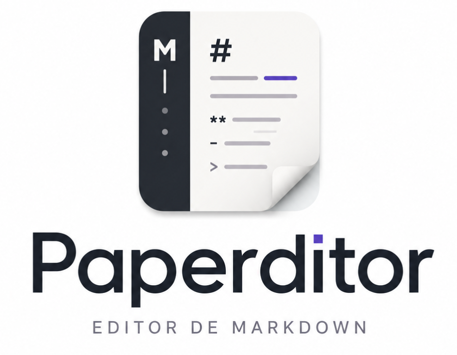
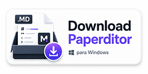
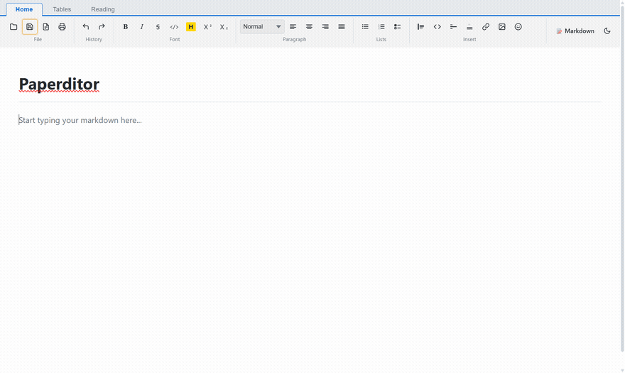
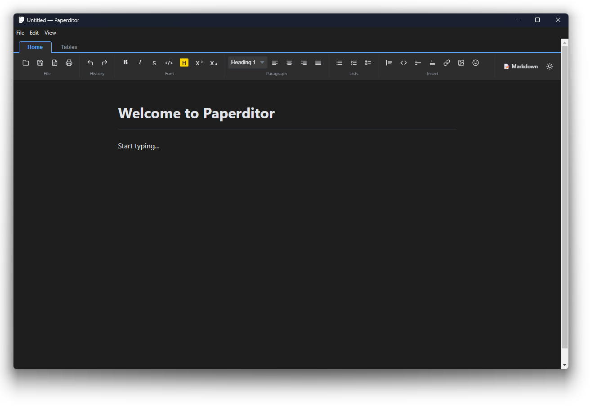
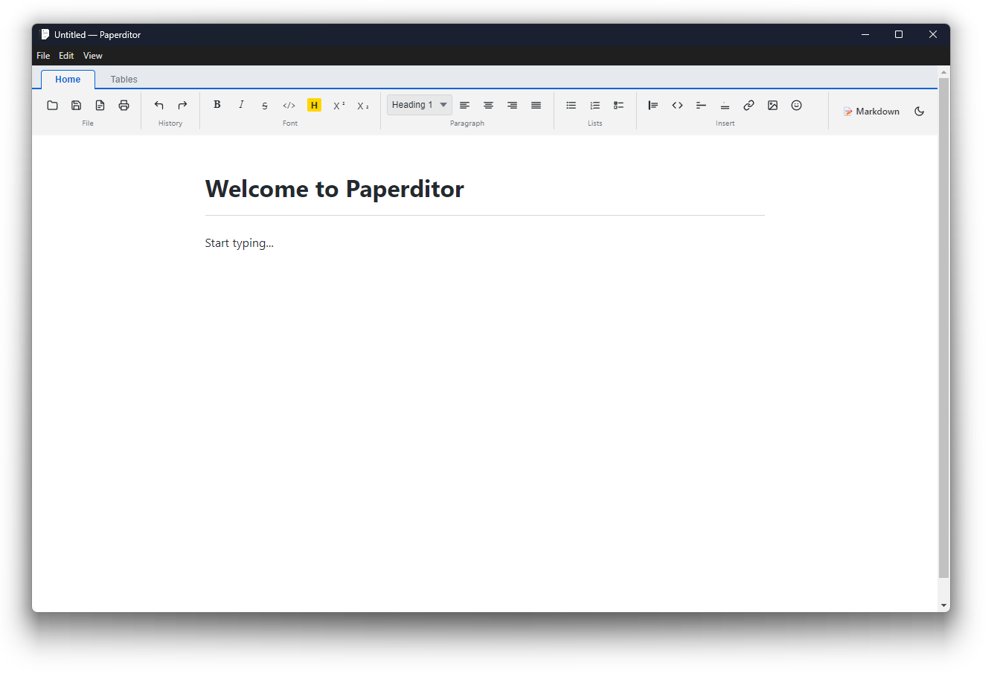

<div align="center">



**A clean, distraction-free Markdown editor.**

Write beautifully. Stay focused. Own your files.

    
 

  


  [](https://github.com/guisaldanha/paperditor/releases/latest)

  [](https://apps.microsoft.com/detail/9NJMJ7SLZZ9M?hl=neutral&ocid=pdpshare)

    
  


</div>

---

## 🎬 Demo

<div align="center">



</div>

---

## ✨ What is Paperditor?

**Paperditor** is a free, open-source desktop Markdown editor that renders your text as you type — no preview pane needed. It feels as natural as a word processor while keeping your content in clean, portable `.md` files that you own forever.

Built for developers, writers, and anyone who loves Markdown.

---

## 🖥️ Screenshots

<div align="center">


|                                                                        |                                                                          |
| :----------------------------------------------------------------------: | :------------------------------------------------------------------------: |
| **🌙 Dark Theme**                                                      | **☀️ Light Theme**                                                       |
|  |  |


</div>

---

## 🚀 Features

### ✍️ Editing Experience

- **WYSIWYG Markdown editing** — content renders live as you type, no split panes
- **Three modes** — switch between rich WYSIWYG Editor, raw Markdown Source, and a read-only Reading view at any time
- **Reading mode** — distraction-free, read-only rendering with syntax-highlighted code blocks (one-click copy button) and a collapsible table of contents
- **Unsaved-changes indicator** — bullet (`•`) in the title bar when you have unsaved work
- **File associations** — double-click any `.md` or `.markdown` file to open it directly in Paperditor's Reading mode; on Windows, right-click → **Edit with Paperditor** opens it straight into the Editor instead
- **Multi-window** — opening another file (via file association or a relaunch) always opens it in a new window, so you can work on several documents side by side

### 📝 Formatting Toolbar


| Category          | Supported                                                                    |
| ----------------- | ---------------------------------------------------------------------------- |
| Headings          | H1 · H2 · H3 · H4 · H5 · H6                                                  |
| Inline            | **Bold** · *Italic* · ~~Strikethrough~~ · ==Highlight== · `Code`             |
| Script            | Superscript · Subscript                                                      |
| Lists             | Bullet · Ordered · Task (checkbox) lists                                     |
| Blocks            | Blockquote · Code block (syntax-highlighted) · Horizontal rule               |
| Links &amp; Media | Hyperlinks · Inline images                                                   |
| Tables            | Insert table · Add/remove rows &amp; columns · Toggle header row/column/cell |
| Alignment         | Left · Center · Right · Justify                                              |
| Extras            | Footnotes · Emoji picker (categorized, searchable)                           |


### 📁 File Operations

- Open, Save, Save As `.md` files
- **Export to PDF, HTML, or Word (.docx)** — available from the Reading tab
- **Print** — send directly to your printer

### 🎨 Themes

- **Light** and **Dark** themes — toggled with a single click, persisted across sessions

### 🔍 Find

- Inline find bar (`Ctrl+F`) — search and jump through matches without leaving the editor or losing your place

---

## ⌨️ Keyboard Shortcuts


| Action                 | Shortcut                  |
| ---------------------- | ------------------------- |
| New file               | `Ctrl+N`                  |
| Open file              | `Ctrl+O`                  |
| Save                   | `Ctrl+S`                  |
| Save As                | `Ctrl+Shift+S`            |
| Export PDF             | `Ctrl+Shift+E`            |
| Print                  | `Ctrl+P`                  |
| Find                   | `Ctrl+F`                  |
| Bold                   | `Ctrl+B`                  |
| Italic                 | `Ctrl+I`                  |
| Undo                   | `Ctrl+Z`                  |
| Redo                   | `Ctrl+Y` / `Ctrl+Shift+Z` |
| Toggle Editor / Source | `Ctrl+'`                  |
| Toggle fullscreen      | `F11`                     |


---

## 📦 Installation

### Download (recommended)

Download the latest Windows installer from the [Releases page](https://github.com/guisaldanha/paperditor/releases/latest) and run the `.exe` setup file, or get it from the **Microsoft Store** for automatic updates and no SmartScreen warning.

<div align="center">

[](https://github.com/guisaldanha/paperditor/releases/latest)

[](https://apps.microsoft.com/detail/9NJMJ7SLZZ9M?hl=neutral&ocid=pdpshare)

</div>

#### macOS / Linux (experimental)

Every release also publishes a `.dmg` (macOS) and `.AppImage` (Linux) build from the same source, generated automatically by CI. They aren't manually tested on those platforms yet, so expect rough edges — [bug reports](https://github.com/guisaldanha/paperditor/issues) are very welcome.

### Build from Source

> Requirements: **Node.js 18+** and **npm**

```bash
# Clone the repository
git clone https://github.com/guisaldanha/paperditor.git
cd paperditor

# Install dependencies
npm install

# Run in development mode
npm run dev

# Build the installer
npm run build
```

The compiled installer will be placed in `release/<version>/`.

---

## ⚠️ Security Warnings (unsigned builds)

None of the installers are code-signed (no paid certificate), so your OS will warn you before running them. The source code is fully open — feel free to review it and build the executable yourself.

- **Windows**: SmartScreen may flag the `.exe` as unrecognized. Click **"More info" → "Run anyway"**.
- **macOS**: Gatekeeper will block the `.dmg` as "damaged" or "from an unidentified developer". Right-click the app → **Open**, or run `xattr -cr /Applications/Paperditor.app` to clear the quarantine flag.
- **Linux**: mark the `.AppImage` as executable before running it: `chmod +x Paperditor-Linux-*.AppImage`.

---

## 🛠️ Tech Stack


| Layer             | Technology                                                                           |
| ----------------- | ------------------------------------------------------------------------------------ |
| Shell             | [Electron](https://www.electronjs.org/)                                              |
| UI                | [React](https://react.dev/) + [TypeScript](https://www.typescriptlang.org/)          |
| Editor Engine     | [TipTap](https://tiptap.dev/)                                                        |
| Markdown Parser   | [@tiptap/markdown](https://tiptap.dev/docs/editor/extensions/functionality/markdown) |
| Code Highlighting | [lowlight](https://github.com/wooorm/lowlight)                                       |
| Office Export     | [html-to-docx](https://www.npmjs.com/package/html-to-docx)                           |
| Bundler           | [Vite](https://vitejs.dev/)                                                          |
| Packaging         | [electron-builder](https://www.electron.build/)                                      |


---

## 🛡️ Security

> **Don't trust. Verify.**

Transparency is part of this project.

Before running any software obtained from the Internet, it's good practice to perform an independent audit of the source code. This repository encourages that practice.

[](https://chatgpt.com/?q=Analyze%20this%20GitHub%20repository%3A%20https%3A%2F%2Fgithub.com%2Fguisaldanha%2Fpaperditor%0A%0APerform%20a%20complete%20security%20audit.%20Analyze%20all%20the%20source%20code%2C%20dependencies%2C%20scripts%2C%20GitHub%20Actions%20workflows%2C%20and%20configuration%20files.%20Identify%20any%20potentially%20malicious%20behavior%2C%20such%20as%20credential%20theft%2C%20hidden%20data%20exfiltration%2C%20remote%20code%20execution%2C%20automatic%20downloads%2C%20cryptocurrency%20mining%2C%20suspicious%20dependencies%2C%20or%20any%20other%20security%20risk.%20Present%20your%20findings%2C%20explain%20the%20identified%20risks%2C%20and%20state%20whether%20you%20consider%20it%20safe%20to%20run%20this%20project.)  
[](https://claude.ai/new?q=Analyze%20this%20GitHub%20repository%3A%20https%3A%2F%2Fgithub.com%2Fguisaldanha%2Fpaperditor%0A%0APerform%20a%20complete%20security%20audit.%20Analyze%20all%20the%20source%20code%2C%20dependencies%2C%20scripts%2C%20GitHub%20Actions%20workflows%2C%20and%20configuration%20files.%20Identify%20any%20potentially%20malicious%20behavior%2C%20such%20as%20credential%20theft%2C%20hidden%20data%20exfiltration%2C%20remote%20code%20execution%2C%20automatic%20downloads%2C%20cryptocurrency%20mining%2C%20suspicious%20dependencies%2C%20or%20any%20other%20security%20risk.%20Present%20your%20findings%2C%20explain%20the%20identified%20risks%2C%20and%20state%20whether%20you%20consider%20it%20safe%20to%20run%20this%20project.)

<sub>💡 Trust in software should come from the ability to verify how it works, not just the reputation of whoever built it.</sub>

---

## 👨‍💻 Author

Developed by **Guilherme Saldanha**

- GitHub: [https://github.com/guisaldanha](https://github.com/guisaldanha)
- Site: [https://guisaldanha.com](https://guisaldanha.com)

---

## ❤️ Support the Developer

If this project saves you time or helps your workflow, consider supporting its development.

Ways to help:

- ⭐ **Star the repository**
- 🔁 **Share with other developers**
- ☕ **[Buy me a coffee by clicking here](https://www.paypal.com/cgi-bin/webscr?cmd=_xclick&amp;business=guisaldanha@gmail.com&amp;item_name=Buy%20a%20coffee%20because%20Paperditor)  (PayPal)**

---

## 📜 License

This project is licensed under the **MIT License**. See the [LICENSE](LICENSE) file for details.

---

<div align="center">

Made with ☕ by [Guilherme Saldanha](https://guisaldanha.com)

</div>

